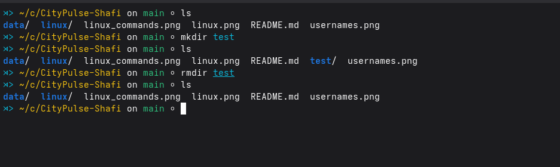
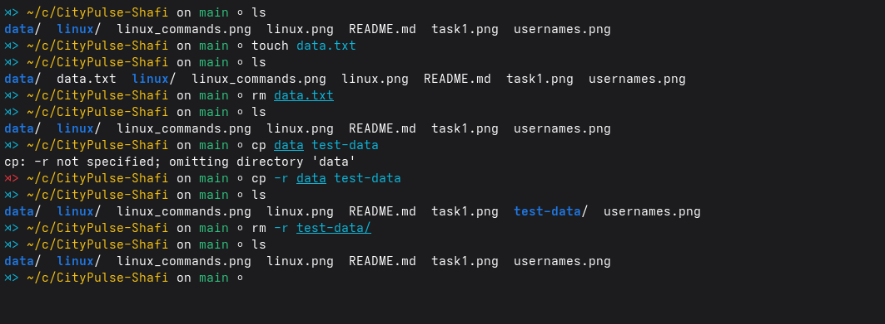
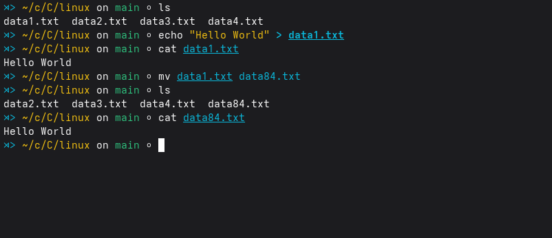
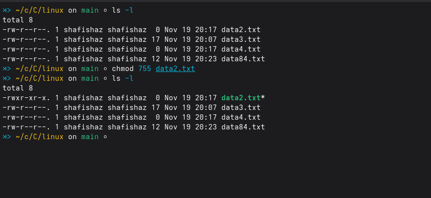
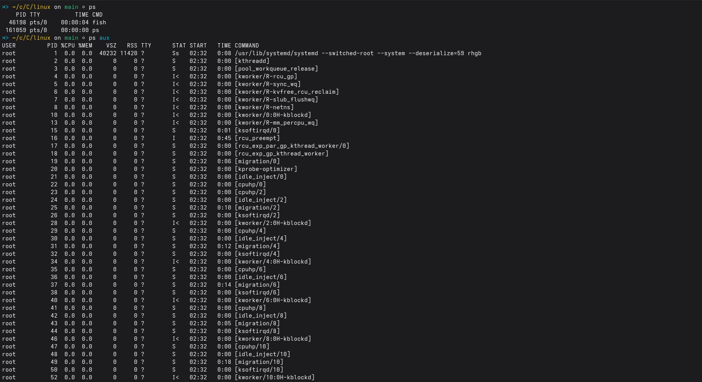
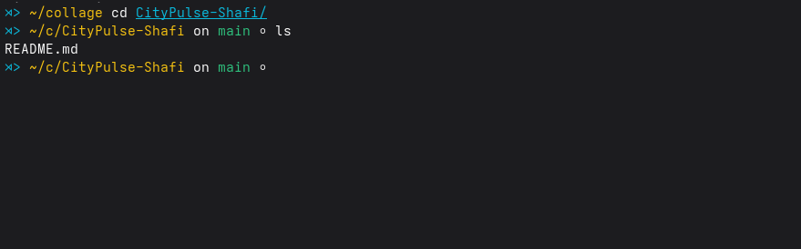
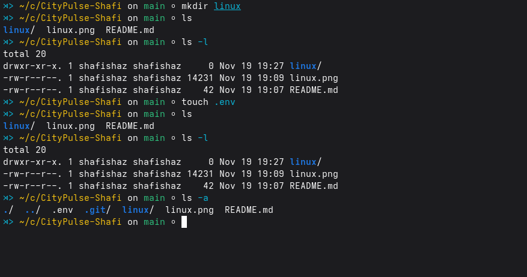
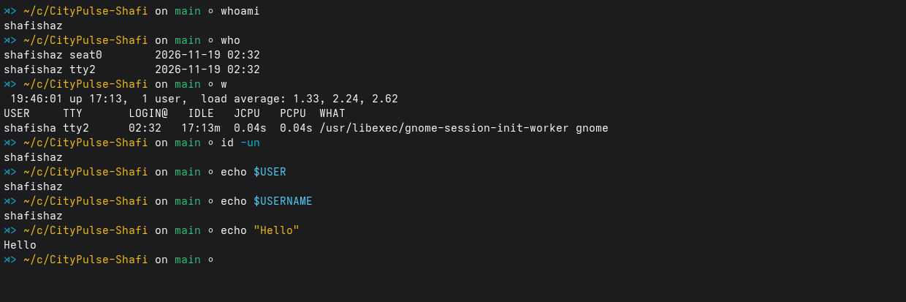

# CityPulse-Shafi

A practical, screenshot-based guide to basic Linux command-line operations. This repository covers directory management, file handling, disk usage, permissions, and process monitoring.

## Table of Contents

- [Task 1: Remove Directories](#task-1-remove-directories)
- [Task 2: Remove Files and Directories](#task-2-remove-files-and-directories)
- [Task 3: Rename Files and Check Disk Usage](#task-3-rename-files-and-check-disk-usage)
- [Task 4: Linux Permissions](#task-4-linux-permissions)
- [Task 5: List Running Processes](#task-5-list-running-processes)
- [Additional Screenshots](#additional-screenshots)

---

## Task 1: Remove Directories

Use `mkdir` to create a directory and `rmdir` to remove an **empty** directory.

```bash
mkdir temp-dir
rmdir temp-dir
```

> `rmdir` only works if the directory is empty. Use `rm -r` or `rm -rf` for directories containing files or subdirectories.

### Screenshot



---

## Task 2: Remove Files and Directories

Use `rm` to remove files and `rm -r` or `rm -rf` to remove directories recursively.

```bash
# Remove a file
rm filename.txt

# Remove a directory and prompt for confirmation
rm -r folder-name

# Remove a directory and its contents without prompting
rm -rf folder-name
```

> ⚠️ **Warning:** `rm -rf` permanently deletes data. Double-check the path before running it.

### Screenshot



---

## Task 3: Rename Files and Check Disk Usage

### Rename a File or Directory

The `mv` command renames or moves files and directories:

```bash
mv old-name.txt new-name.txt
mv old-folder-name new-folder-name
mv filename.txt folder/filename.txt
```

### Check Disk Usage

Use `df -h` to display available space on mounted filesystems:

```bash
df -h
```

Use `du` to display directory and file sizes:

```bash
# Show the size of the current directory and its contents
du -h

# Show a summary for the current directory
du -sh

# Show a summary for a specific directory
du -sh folder-name
```

### Screenshot



---

## Task 4: Linux Permissions

Linux files and directories have three permission types:

| Permission | Symbol | Meaning |
| :--------- | :----: | :------ |
| Read | `r` | View file contents or list directory contents |
| Write | `w` | Modify a file or change directory contents |
| Execute | `x` | Run a file as a program or enter a directory |

Permissions are assigned separately to the **owner**, **owner's group**, and **other users**.

### Change Permissions

```bash
# Add execute permission for the owner
chmod u+x script.sh

# Give the owner read and write permissions
chmod u+rw file.txt

# Make a file readable and writable by everyone
chmod 666 file.txt

# Owner: full permissions; group and others: read/execute
chmod 755 script.sh
```

View permissions with:

```bash
ls -l
```

### Common Permission Modes

| Mode | Owner | Group | Others |
| :--: | :---- | :---- | :----- |
| `644` | Read + write | Read | Read |
| `755` | Read + write + execute | Read + execute | Read + execute |
| `777` | Full access | Full access | Full access |

### Screenshot



---

## Task 5: List Running Processes

Use `ps` to view processes in the current terminal:

```bash
ps
```

Use `ps aux` to list processes from the entire system:

```bash
ps aux
```

Search for a specific process:

```bash
ps aux | grep process-name
```

Use `top` for an interactive process viewer:

```bash
top
```

Press `q` to exit `top`.

### Screenshot



---

## Additional Screenshots

| Screenshot | Description |
| :--------- | :---------- |
|  | Linux terminal overview |
|  | Linux command examples |
|  | Terminal usernames |

